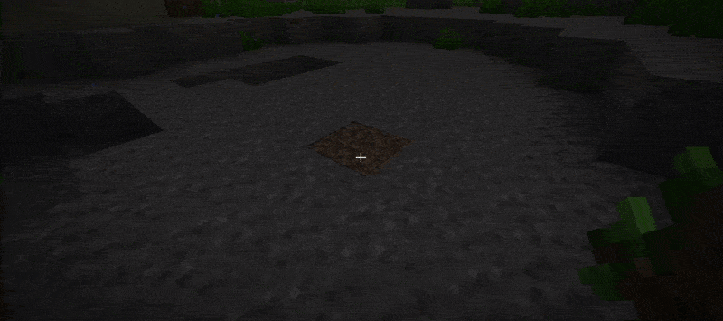

# UnderwaterTrees 🌊

Let your players plant saplings below the surface without weird hacks. UnderwaterTrees keeps placement safe, respects your land-protection plugins, and helps underwater saplings actually grow.

## Why server owners love it

- 🌱 Custom soil + sapling allowlists mean only the trees you approve can grow underwater.
- 🛡️ Stability guard keeps flowing water and physics updates from breaking saplings that sit underwater on an allowed soil.
- 🔐 Saplings are only placed where the target is actually water, protection plugins (WorldGuard, GriefPrevention, …) can veto placement and the growth of underwater trees, and the `underwatertrees.place` permission lets you disable underwater planting per player or group.
- 💡 Optional light override lets saplings grow underwater where the light is too low for vanilla, down to the pitch-dark deep-sea floor.
- 🔁 Live reload + config watcher merge new defaults automatically—edit, save, done. Upgrades from 1.x back up the old files and carry your settings over.
- 🔔 Update checker (Modrinth + Hangar) and join reminders keep your fleet current.
- 🌐 14 bundled languages, all MiniMessage-powered, so you can style player + console feedback exactly the way you like.

## Quick start

UnderwaterTrees needs Paper 26.3.x and Java 25 (Spigot/vanilla are not supported).

1. Download the latest `underwatertrees-paper-<version>.jar` from [Modrinth](https://modrinth.com/plugin/underwatertrees) or [Hangar](https://hangar.papermc.io/hro_basti/underwatertrees) and drop it into `plugins/`.
2. Start the server once. `config.yml`, `lang/`, and defaults appear under `plugins/UnderwaterTrees/`.
3. Adjust the config (materials, chat prefix, watcher flags) and run `/underwatertrees reload`.

Edits to `config.yml` are picked up automatically by the config watcher; after editing `lang/`, run `/underwatertrees reload`.

## Upgrading from 1.x

Swap the jar and start the server: your old files move to `plugins/UnderwaterTrees/backup-1.x/`, fresh files are created with every setting you had changed carried over, and the console lists exactly what happened. The [upgrade notes](https://github.com/hrobasti/underwatertrees-plugin/wiki#upgrading-from-1x) list what behaves differently in 2.0, such as the new `underwatertrees.place` permission. Coming from 1.0 or 1.0.1, your files are backed up the same way, but their settings can't be carried over: re-apply your changes from the backup.

## Documentation

- [Wiki: admin guide](https://github.com/hrobasti/underwatertrees-plugin/wiki): every setting, commands and permissions, languages, troubleshooting.
- [Wiki: developer guide](https://github.com/hrobasti/underwatertrees-plugin/wiki/2-%E2%80%90-Developer-Guide): building from source, tests, releases, contributing.

## License & Credits

- UnderwaterTrees is released under the MIT License (see `LICENSE`), Copyright (c) 2025-2026 [kroet.net](https://kroet.net). Releases before 2.0.0 were published under the Apache License 2.0; kroet.net additionally makes them available under the MIT License.
- The MIT License covers the code, not the name: forks should use a different plugin name and must not suggest they are the official UnderwaterTrees.
- Includes TurtleLib by [kroet.net](https://kroet.net) (MIT); its license text ships at `licenses/turtle-lib-MIT.txt` inside the jar.
- Includes bStats Metrics (MIT, Copyright (c) 2021 Bastian Oppermann); its license text ships at `licenses/bstats-MIT.txt`. MiniMessage and Gson are provided by Paper at runtime. All bundled and runtime-provided libraries are listed in `THIRD_PARTY_LICENSES.md`.
- Parts of this plugin and its documentation were produced with AI assistance and reviewed by the maintainer before release.
