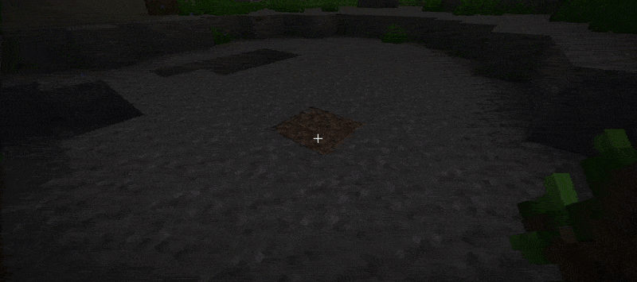

# Underwater Trees 🌊

Let your players plant saplings below the surface without weird hacks. Underwater Trees keeps placement safe, respects your land-protection plugins, and helps underwater saplings actually grow.

## Why server owners love it

- 🌱 Custom soil + sapling allowlists mean only the trees you approve can grow underwater.
- 🛡️ Stability guard keeps flowing water and physics updates from breaking saplings that sit underwater on an allowed soil.
- 🔐 Saplings are only placed where the target is actually water, protection plugins (WorldGuard, GriefPrevention, …) can veto placement and the growth of underwater trees, and the `underwatertrees.place` permission lets you disable underwater planting per player or group.
- 💡 Optional light override lets saplings grow underwater where the light is too low for vanilla, down to the pitch-dark deep-sea floor.
- 🔁 Live reload + config watcher merge new defaults automatically—edit, save, done. Upgrades from 1.x back up the old files and carry your settings over.
- 🔔 Update checker (Modrinth + Hangar) and join reminders keep your fleet current.
- 🌐 14 bundled languages, all MiniMessage-powered, so you can style player + console feedback exactly the way you like.

## Quick start

Underwater Trees needs Paper 26.3.x and Java 25 (Spigot/vanilla are not supported).

1. Download the latest `underwatertrees-paper-<version>.jar` from [Modrinth](https://modrinth.com/plugin/underwatertrees) or [Hangar](https://hangar.papermc.io/hro_basti/underwatertrees) and drop it into `plugins/`.
2. Start the server once. `config.yml`, `lang/`, and defaults appear under `plugins/UnderwaterTrees/`.
3. Adjust the config (materials, chat prefix, watcher flags) and run `/underwatertrees reload`.

Edits to `config.yml` are picked up automatically by the config watcher; after editing `lang/`, run `/underwatertrees reload`.

## Upgrading from 1.x

Swap the jar and start the server: your old files move to `plugins/UnderwaterTrees/backup-1.x/`, fresh files are created with every setting you had changed carried over, and the console lists exactly what happened. The [upgrade notes](https://github.com/hrobasti/underwatertrees-plugin/wiki#upgrading-from-1x) list what behaves differently in 2.0, such as the new `underwatertrees.place` permission. Coming from 1.0 or 1.0.1, your files are backed up the same way, but their settings can't be carried over: re-apply your changes from the backup.

## Update check & privacy

Underwater Trees contacts two services from your server; players' game clients never do.

- **Update check:** at start and then every `update_check.interval_hours` (default 24), the server asks `api.modrinth.com` (Modrinth) and `hangar.papermc.io` (Hangar) for the plugin's published versions. Sent: the server's IP address (part of every web request), the user agent `UnderwaterTrees-UpdateChecker` and the project ID. No player or world data. Pick one platform with `update_check.provider`, or switch the check off with `update_check.enabled: false`.
- **Usage statistics (bStats):** every 30 minutes the server sends anonymous statistics to `bstats.org`: a random server ID created by bStats, player count, online mode, server software and version, Java version, operating system and CPU core count, the plugin's version, and its charts (language, number of allowed saplings and soils). Switch it off for Underwater Trees with `metrics_enabled: false`, or for all plugins with `enabled: false` in `plugins/bStats/config.yml`. More: [bStats for server owners](https://bstats.org/docs/server-owners).

## Documentation

- [Wiki: admin guide](https://github.com/hrobasti/underwatertrees-plugin/wiki): every setting, commands and permissions, languages, troubleshooting.
- [Wiki: developer guide](https://github.com/hrobasti/underwatertrees-plugin/wiki/2-%E2%80%90-Developer-Guide): building from source, tests, releases, contributing.

## License & Credits

- Underwater Trees is released under the MIT License (see `LICENSE`), Copyright (c) 2025-2026 [kroet.net](https://kroet.net). Releases before 2.0.0 were published under the Apache License 2.0; kroet.net additionally makes them available under the MIT License.
- The MIT License covers the code, not the name: forks should use a different plugin name and must not suggest they are the official Underwater Trees.
- Bundled libraries, their licenses and the libraries Paper provides are listed in [`THIRD_PARTY_NOTICES.md`](THIRD_PARTY_NOTICES.md); the license texts of the bundled ones ship under `licenses/` inside the jar.
- Parts of this plugin and its documentation were produced with AI assistance and reviewed by the maintainer before release.
